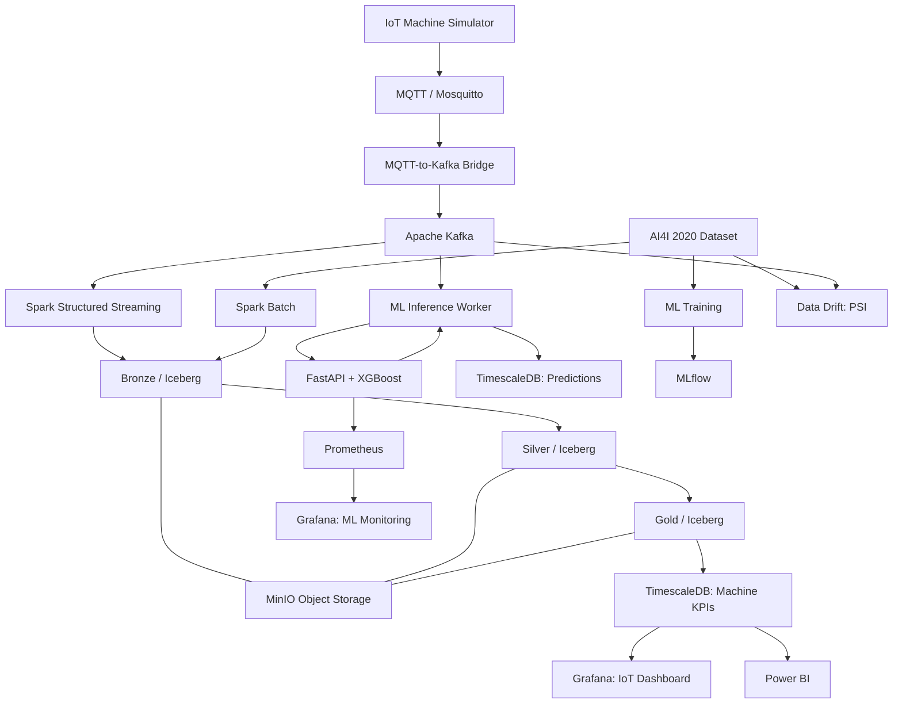

# IndustryPulse — Industrial IoT Data Platform

An end-to-end personal project where I explore how to collect, process, analyze, and monitor industrial machine data using Big Data and Machine Learning technologies.

I built IndustryPulse to understand how different tools work together in one data platform, from simulated IoT sensors to dashboards and predictive maintenance.

## What I built

IndustryPulse combines two data workflows:

- **Real-time IoT data:** five simulated machines (M001–M005) send measurements through MQTT and Kafka.
- **Historical data:** the AI4I 2020 Predictive Maintenance Dataset (10,000 records) is used for batch analysis and ML training.

I use a **Bronze → Silver → Gold** architecture to organize raw, cleaned, and aggregated data. I also built a separate real-time ML inference path that reads Kafka events, predicts machine failure risk, and stores the results in TimescaleDB.

## Architecture



The ML inference path runs in parallel with Spark processing. Airflow is used separately for orchestration experiments, rather than being required to run the real-time ML path.

## Technologies

| Area | Tools |
|---|---|
| Programming | Python, SQL |
| IoT messaging | MQTT, Eclipse Mosquitto |
| Event streaming | Apache Kafka |
| Data processing | Apache Spark 3.5, PySpark, Spark Structured Streaming |
| Lakehouse | Apache Iceberg, MinIO, Medallion Architecture |
| Database | PostgreSQL, TimescaleDB |
| Dashboards | Grafana, Power BI |
| Machine Learning | scikit-learn, XGBoost, pandas |
| Model serving | FastAPI |
| MLOps | MLflow, Prometheus, Grafana, PSI data drift monitoring |
| Automation | GitHub Actions, pytest |
| Orchestration experiments | Apache Airflow |
| Analytics engineering | dbt Core (work in progress) |
| Infrastructure | Docker, Docker Compose |

## 1. Real-time IoT pipeline

I simulate five industrial machines and generate sensor measurements such as temperature, vibration, pressure, energy consumption, machine status, and timestamps.

The streaming flow is:

```text
IoT Simulator → MQTT → Kafka → Spark Structured Streaming
                                      ↓
                          Bronze → Silver → Gold
                                      ↓
                               TimescaleDB
                                      ↓
                              Grafana / Power BI
```

MQTT handles lightweight communication, Kafka transports the events, and Spark processes the data. In the Gold layer, I calculate machine-level KPIs using one-minute event-time windows.

### Main KPIs

- Number of measurements per machine
- Average, minimum, and maximum temperature
- Average and maximum vibration
- Average pressure and energy consumption
- Total alerts and alert rate

I store the resulting KPIs in `public.machine_kpi` in TimescaleDB.

## 2. Batch processing and Lakehouse

For the batch workflow, I use the **AI4I 2020 Predictive Maintenance Dataset**, which contains 10,000 records.

With PySpark, I work on data cleaning, validation, standardizing columns, temperature conversion, and creating additional industrial features. The processed data is organized into Iceberg tables on MinIO.

```text
industrypulse
├── bronze
│   ├── ai4i_raw
│   └── machine_sensors_raw
├── silver
│   ├── ai4i_clean
│   └── machine_sensors_clean
└── gold
    └── machine_kpi
```

The Iceberg warehouse uses the S3-compatible path `s3a://industrypulse/warehouse`.

## 3. Data quality and alerts

In the streaming pipeline, I validate sensor readings and identify suspicious measurements. I also calculate alerts based on simulation thresholds, such as high temperature or vibration.

The Silver layer includes fields such as `temperature_alert`, `vibration_alert`, `sensor_alert`, and `data_quality_status`.

These thresholds are for simulation and learning, not industrial safety recommendations.

## 4. Predictive maintenance with XGBoost

I added a Machine Learning pipeline to predict machine failure risk using the AI4I dataset.

The model uses five input features:

- Air temperature (K)
- Process temperature (K)
- Rotational speed (rpm)
- Torque (Nm)
- Tool wear (min)

I compared ML approaches during training and deployed an XGBoost model with a decision threshold of **0.33**, selected to prioritize recall.

The trained model is loaded by a **FastAPI** service. A Kafka inference worker reads live machine events, validates the input, calls `/predict`, and saves the result in `public.machine_predictions` in TimescaleDB.

Example prediction request:

```json
{
  "air_temperature": 300,
  "process_temperature": 310,
  "rotational_speed": 1500,
  "torque": 40,
  "tool_wear": 100
}
```

The API returns a failure probability, prediction, threshold, and status (`NORMAL` or `FAILURE_RISK`).

### API endpoints

| Endpoint | Purpose |
|---|---|
| `GET /health` | Check API and model availability |
| `POST /predict` | Predict machine failure risk |
| `GET /metrics` | Expose Prometheus metrics |

Local API: `http://localhost:8000`.

## 5. Experiment tracking with MLflow

I use **MLflow** to track training runs and compare model results. The training script logs metrics such as accuracy, precision, recall, F1-score, validation F1-score, model parameters, and artifacts.

MLflow is available locally at `http://localhost:5000` when its container is running.

## 6. Data drift monitoring

I added a Python script, `ml/src/data_drift.py`, to compare the AI4I training dataset with recent IoT messages from Kafka.

The script uses **Population Stability Index (PSI)** for the five model input features. In one test, I compared **10,000 reference records** with **1,000 recent Kafka events**.

| Feature | PSI | Result |
|---|---:|---|
| Air temperature | 0.5189 | High drift |
| Process temperature | 0.8214 | High drift |
| Rotational speed | 1.0089 | High drift |
| Torque | 0.1110 | Moderate drift |
| Tool wear | 0.2630 | High drift |

For this project, I use PSI below 0.10 as stable, 0.10–0.20 as moderate drift, and 0.20 or above as high drift. These are monitoring heuristics.

The script generates `ml/reports/data_drift.json`. Because the IoT data is simulated, high drift may reflect differences between the simulator and the historical dataset. It does **not** prove that the model's accuracy has decreased.

## 7. Monitoring with Prometheus and Grafana

I added Prometheus metrics to the FastAPI service and connected them to Grafana.

I monitor:

- Total predictions
- Predictions by status (`NORMAL` / `FAILURE_RISK`)
- Prediction processing errors
- Input validation errors (HTTP 422)
- Prediction latency

Useful PromQL queries:

```promql
sum(industrypulse_predictions_total)
```

```promql
sum by (status) (industrypulse_predictions_total)
```

```promql
sum(industrypulse_prediction_errors_total)
```

```promql
sum(industrypulse_validation_errors_total)
```

```promql
sum(rate(industrypulse_prediction_duration_seconds_sum[5m]))
/
sum(rate(industrypulse_prediction_duration_seconds_count[5m]))
```

Local services when started:

| Service | URL |
|---|---|
| FastAPI metrics | `http://localhost:8000/metrics` |
| Prometheus | `http://localhost:9090` |
| Grafana | `http://localhost:3001` |
| MLflow | `http://localhost:5000` |

I also built a separate Grafana dashboard for industrial machine KPIs stored in TimescaleDB.

## 8. Automated tests with GitHub Actions

I created a GitHub Actions workflow at `.github/workflows/ml-ci.yml`.

On pushes and pull requests targeting `main`, the workflow:

1. Sets up Python 3.11.
2. Installs the ML dependencies.
3. Checks Python syntax.
4. Runs the FastAPI tests with pytest.

The tests cover `/health`, `/metrics`, invalid inputs, missing fields, and validation error metrics. The workflow has run successfully on GitHub Actions.

This is **Continuous Integration (CI)**. I have not added automatic production deployment (CD).

## 9. Dashboards and analytics

I use **Grafana** for operational monitoring and **Power BI** for industrial KPI analysis. The TimescaleDB serving layer stores windowed measurements and alert counts, while the prediction table stores XGBoost inference results.

Example SQL query:

```sql
SELECT
    machine_id,
    window_start,
    avg_temperature,
    avg_vibration,
    avg_energy,
    total_alerts,
    alert_rate
FROM public.machine_kpi
ORDER BY window_start DESC
LIMIT 20;
```

## 10. Airflow and dbt

I experimented with **Apache Airflow** to learn how DAGs schedule and monitor processing tasks. I tested DAG executions, but I do not keep Airflow running alongside the entire platform because of the memory usage on my local machine.

I also prepared a **dbt Core** project for SQL transformations and analytical models. Its model development and validation are still in progress.

## 11. Repository structure

```text
IndustryPulse/
├── .github/
│   └── workflows/
│       └── ml-ci.yml
├── data/
│   └── raw/                   # Local AI4I dataset
├── src/                       # IoT simulator and MQTT-Kafka bridge
├── spark/                     # Batch, Bronze, Silver, Gold jobs
├── ml/
│   ├── src/
│   │   ├── api.py
│   │   ├── train.py
│   │   └── data_drift.py
│   ├── inference_worker/
│   │   └── worker.py
│   ├── tests/
│   │   └── test_api.py
│   └── reports/
├── airflow/                   # Orchestration experiments
├── dbt/                       # Analytics engineering work
├── POWER_BI/                  # Power BI report
├── docker-compose.yml
├── docker-compose.streaming.yml
└── README.md
```

Some datasets, model artifacts, experiment runs, and runtime data are kept locally and are not included in the Git repository.

## 12. Running the project

### Prerequisites

- Docker Desktop and Docker Compose
- Git
- Python 3.11 for local ML development
- The AI4I dataset and trained model artifacts for the relevant batch/ML steps
- Environment variables and service configuration for the Docker setup

Clone the repository:

```bash
git clone https://github.com/oumaymazerrik/IndustryPulse-Industrial-IoT-Data-Platform.git
cd IndustryPulse-Industrial-IoT-Data-Platform
```

Check the Docker Compose configuration before starting services:

```bash
docker compose config
```

Start only the services needed for the task. For example, if the containers already exist locally, I can start the monitoring components with:

```powershell
docker start industrypulse-ml-api industrypulse-prometheus industrypulse-grafana
```

Check the running containers:

```powershell
docker ps
```

I avoid deleting Docker volumes or streaming checkpoints because they contain important data and state. The full environment is not intended to be started all at once on a memory-limited laptop.

## 13. Challenges and what I learned

Some of the main challenges I faced were:

- **Kafka offsets and Spark checkpoints:** I learned to protect streaming state before making changes.
- **Docker resource usage:** Running Spark, Kafka, Airflow, and monitoring tools together can overload a local machine, so I test services in smaller groups.
- **Grafana time ranges:** A dashboard can show “No data” if the selected time window does not match the timestamps stored in the database.
- **ML monitoring:** I learned that HTTP 422 input-validation errors happen before the model prediction function and need separate monitoring.
- **Data drift:** Comparing simulated live data with historical training data helped me understand the difference between changing input distributions and actual model performance.
- **CI debugging:** My first GitHub Actions run failed because the test file was empty. After fixing the file, the automated tests passed.

I developed the project step by step and tested each part before moving to the next one.

## 14. Current status

| Component | Status |
|---|---|
| IoT simulator, MQTT, Kafka | Implemented and tested |
| Spark batch and streaming | Implemented and tested |
| Bronze / Silver / Gold with Iceberg and MinIO | Implemented |
| TimescaleDB serving layer | Implemented |
| Grafana industrial dashboard | Implemented |
| Power BI dashboard | Implemented |
| XGBoost predictive maintenance | Trained and deployed locally |
| Kafka ML inference worker | Implemented and tested |
| FastAPI prediction service | Implemented and tested |
| MLflow experiment tracking | Implemented |
| PSI data drift report | Implemented and tested |
| Prometheus and Grafana ML monitoring | Integrated and tested |
| GitHub Actions CI | Passing |
| Airflow DAG experiments | Tested; run on demand |
| dbt analytical models | In progress |
| Automated production deployment | Not implemented |

## 15. Next improvements

I would like to improve the project by:

- Finishing the dbt staging models and analytical marts.
- Adding more automated tests for the data pipeline and ML worker.
- Making the deployment and service startup more reproducible.
- Extending data drift monitoring and alerting.
- Improving dashboard documentation and adding screenshots.

## Author

**Oumayma Zerrik**  
Master's student in Big Data & IoT  
Interested in Data Engineering, Machine Learning, and MLOps.

GitHub: [oumaymazerrik](https://github.com/oumaymazerrik)

---

*IndustryPulse is a personal learning project. The machines and sensor events are simulated, and the platform is designed for experimentation rather than production industrial use.*
