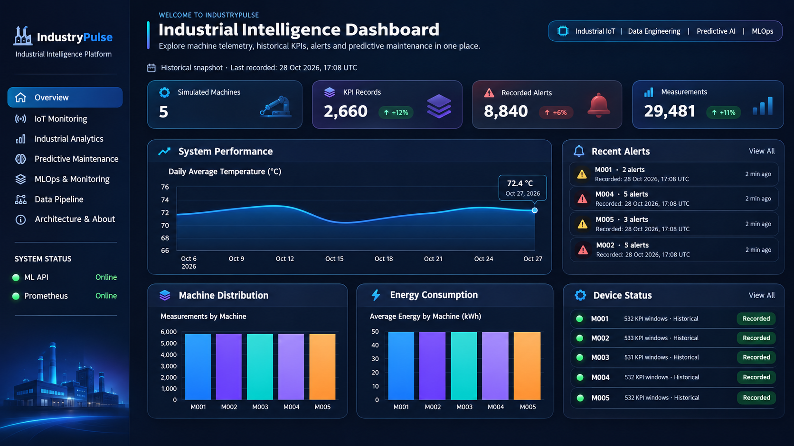

# 🏭 IndustryPulse — Industrial IoT Data Platform

**End-to-End Data Engineering | Industrial IoT | Big Data | Machine Learning | MLOps**

An end-to-end personal project where I explore how to collect, process, analyze, and monitor industrial machine data using Big Data and Machine Learning technologies.

I built IndustryPulse to understand how different tools work together in one data platform, from simulated IoT sensors to dashboards and predictive maintenance.

---

## 🖥️ Industrial Intelligence Dashboard

<p align="center">
  
</p>

<p align="center">
  <em>IndustryPulse — Industrial Intelligence Dashboard Design Preview</em>
</p>

The dashboard is built with **Streamlit**, providing a centralized interface for exploring industrial machine data, monitoring historical KPIs, and interacting with the predictive maintenance model.

### Dashboard Features

- **Overview:** Industrial KPIs, machine statistics, recorded alerts, and measurements.
- **IoT Monitoring:** Temperature, vibration, and energy consumption trends.
- **Industrial Analytics:** Machine comparisons, aggregated statistics, and historical trends.
- **Predictive Maintenance:** XGBoost failure predictions through FastAPI.
- **MLOps & Monitoring:** Prometheus metrics, model monitoring, and data drift reports.
- **Data Pipeline:** Overview of the streaming and lakehouse architecture.
- **Architecture & About:** Project documentation and technology stack.

> **Note:** The image above is a design preview. The implemented Streamlit application uses real historical records from TimescaleDB. Historical values are not presented as live measurements.

---

## 🎯 What I Built

IndustryPulse combines two main data workflows:

- **Real-time IoT Data:** Five simulated machines (M001–M005) send measurements through MQTT and Apache Kafka.
- **Historical Data:** The AI4I 2020 Predictive Maintenance Dataset (10,000 records) is used for batch analysis and machine learning training.

I use a **Bronze → Silver → Gold** architecture to organize raw, cleaned, and aggregated data.

I also built a separate machine learning inference pipeline that reads Kafka events, predicts machine failure risk, and stores the results in TimescaleDB.

The project integrates data ingestion, stream processing, analytical storage, visualization, machine learning, and observability.

---

## 🏗️ Architecture

### 1. Industrial IoT Streaming Pipeline

```text
             Industrial IoT Simulator
                  (5 Machines)
                        |
                        v
                 MQTT / Mosquitto
                        |
                        v
                  MQTT-Kafka Bridge
                        |
                        v
                   Apache Kafka
                  machine-sensors
                        |
                        v
               Spark Structured Streaming
                        |
              +---------+---------+
              |         |         |
              v         v         v
            Bronze    Silver     Gold
           Raw Data  Clean Data  KPIs
              |         |         |
              +---------+---------+
                        |
                        v
                Iceberg / MinIO
                        |
                        v
                   TimescaleDB
                        |
             +----------+----------+
             |          |          |
             v          v          v
          Grafana     Power BI   Streamlit
```

### 2. Predictive Maintenance Pipeline

```text
                 Apache Kafka
                      |
                      v
                ML Inference Worker
                      |
                      v
                 FastAPI + XGBoost
                      |
              +-------+-------+
              |               |
              v               v
          TimescaleDB      Prometheus
              |               |
              v               v
          Predictions       Grafana
              |
              v
           Streamlit
```

### 3. MLOps Workflow

```text
                AI4I 2020 Dataset
                        |
                        v
                 Data Preparation
                        |
                        v
                  Model Training
                        |
                        v
                  Model Evaluation
                        |
                        v
               MLflow Experiment Tracking
                        |
                        v
                   XGBoost Model
                        |
                        v
                    FastAPI
                        |
               +--------+--------+
               |                 |
               v                 v
           Prometheus        Drift Analysis
               |
               v
             Grafana

      GitHub Actions → Automated API Tests
```

---

## 🛠️ Technology Stack

| Category | Technologies |
|---|---|
| Programming | Python, SQL |
| IoT Communication | MQTT, Eclipse Mosquitto |
| Event Streaming | Apache Kafka |
| Data Processing | Apache Spark, PySpark |
| Data Lakehouse | Apache Iceberg, MinIO |
| Database | PostgreSQL, TimescaleDB |
| Data Visualization | Streamlit, Grafana, Power BI, Plotly |
| Machine Learning | XGBoost, Scikit-learn, Pandas |
| Model Serving | FastAPI |
| Experiment Tracking | MLflow |
| Monitoring | Prometheus, Grafana |
| Data Drift | Population Stability Index (PSI) |
| Containerization | Docker, Docker Compose |
| CI | GitHub Actions |
| Orchestration | Apache Airflow (experimental) |

---

## 📡 IoT Data Generation

The project simulates five industrial machines:

- M001
- M002
- M003
- M004
- M005

Each machine generates sensor measurements that are published through MQTT.

### Sensor Data

| Measurement | Description |
|---|---|
| Temperature | Machine temperature |
| Vibration | Vibration measurements |
| Energy | Energy consumption |
| Speed | Machine rotational speed |
| Status | Machine operating condition |
| Alerts | Detected operating alerts |

### Data Flow

1. The simulator generates industrial measurements.
2. Mosquitto receives MQTT messages.
3. The MQTT-Kafka bridge forwards the messages to Kafka.
4. Spark Structured Streaming processes the events.
5. Processed data is stored for analytics and visualization.

**Kafka topic:** `machine-sensors`

---

## ⚡ Data Engineering Pipeline

The data engineering pipeline follows the Medallion Architecture.

### 🥉 Bronze Layer

The Bronze layer stores raw industrial events.

Its purpose is to preserve incoming data for traceability and potential reprocessing.

### 🥈 Silver Layer

The Silver layer prepares the data for analytics.

Processing includes:

- Data validation
- Cleaning
- Schema handling
- Data transformation

### 🥇 Gold Layer

The Gold layer contains aggregated industrial KPIs.

Examples include:

- Average temperature
- Average vibration
- Average energy consumption
- Number of measurements
- Number of alerts
- Alert rate

The processed data is made available for downstream analysis and dashboards.

---

## 🗄️ TimescaleDB — Industrial Analytics

TimescaleDB is used to store industrial time-series KPIs.

The main table is:

`public.machine_kpi`

### Historical Data Snapshot

| Metric | Value |
|---|---:|
| Simulated Machines | 5 |
| KPI Records | 2,660 |
| Recorded Alerts | 8,840 |
| Measurements | 29,481 |

**Last recorded KPI window:** October 28, 2026, at 17:08 UTC.

These values describe a historical database snapshot, not a live production environment.

### Example SQL Query

```sql
SELECT
    machine_id,
    COUNT(*) AS total_windows,
    AVG(avg_temperature) AS avg_temperature,
    AVG(avg_vibration) AS avg_vibration,
    SUM(total_alerts) AS total_alerts
FROM public.machine_kpi
GROUP BY machine_id
ORDER BY machine_id;
```

---

## 🧠 Predictive Maintenance

IndustryPulse includes a machine learning component that estimates machine failure probability.

### Dataset

The model is trained using the **AI4I 2020 Predictive Maintenance Dataset**, containing 10,000 records.

### Model

**Algorithm:** XGBoost

The model uses five input features:

| Feature | Description |
|---|---|
| Air Temperature | Air temperature (K) |
| Process Temperature | Process temperature (K) |
| Rotational Speed | Rotational speed (rpm) |
| Torque | Torque (Nm) |
| Tool Wear | Tool wear (min) |

The trained model is exposed through a FastAPI REST service.

### Prediction API

**Endpoint:** `POST /predict`

Example request:

```json
{
  "air_temperature": 300.0,
  "process_temperature": 310.0,
  "rotational_speed": 1500,
  "torque": 40.0,
  "tool_wear": 100
}
```

The API returns the estimated failure probability and the prediction decision.

**Configured decision threshold:** `0.33`

### API Endpoints

| Endpoint | Description |
|---|---|
| `/health` | API health check |
| `/predict` | Machine failure prediction |
| `/metrics` | Prometheus metrics |

The model is an educational prototype and is not intended for safety-critical industrial deployment.

---

## 🔬 MLOps & Monitoring

The MLOps component focuses on experiment tracking, model serving, and observability.

### MLflow

MLflow is used to track machine learning experiments.

Tracked information includes:

- Model parameters
- Evaluation metrics
- Training runs
- Model artifacts

### Prometheus

Prometheus collects monitoring metrics from the inference API.

Examples include:

- Prediction requests
- Prediction errors
- API latency
- Service availability

### Grafana

Grafana provides dashboards for exploring monitoring metrics and industrial KPIs.

### Data Drift

IndustryPulse includes a data drift analysis using the **Population Stability Index (PSI)**.

The analysis compares reference training data with sampled industrial measurements.

The drift report is stored at:

`ml/reports/data_drift.json`

This is a generated analysis report, not a continuously running drift detection service.

---

## 📊 Visualization & Analytics

IndustryPulse includes three visualization interfaces.

### Streamlit — Industrial Intelligence Dashboard

The Streamlit application provides seven pages:

1. Overview
2. IoT Monitoring
3. Industrial Analytics
4. Predictive Maintenance
5. MLOps & Monitoring
6. Data Pipeline
7. Architecture & About

It connects to TimescaleDB, FastAPI, and Prometheus.

### Grafana

Grafana is used for industrial and operational monitoring.

Example dashboards include:

- Temperature trends
- Vibration trends
- Energy consumption
- Machine alerts
- API monitoring metrics

### Power BI

Power BI provides an additional reporting layer for industrial data analysis.

---

## 🐳 Docker Deployment

The project uses Docker to containerize its services.

### Prerequisites

- Docker Desktop
- Docker Compose
- Git
- An existing IndustryPulse TimescaleDB service
- PostgreSQL credentials

### Clone the Repository

```bash
git clone https://github.com/oumaymazerrik/IndustryPulse-Industrial-IoT-Data-Platform.git

cd IndustryPulse-Industrial-IoT-Data-Platform
```

### Build the Streamlit Image

From the project root:

```powershell
docker build -t industrypulse-streamlit .\streamlit
```

### Configure the Database Password

```powershell
$env:DB_PASSWORD = Read-Host "PostgreSQL password" -MaskInput
```

### Run Streamlit

```powershell
docker run -d `
  --name industrypulse-streamlit `
  --network industrypulse_default `
  -p 8501:8501 `
  --memory 384m `
  -e DB_HOST=industrypulse-timescaledb `
  -e DB_PASSWORD=$env:DB_PASSWORD `
  -e API_URL=http://industrypulse-ml-api:8000 `
  -e PROMETHEUS_URL=http://industrypulse-prometheus:9090 `
  -v "${PWD}\ml\reports:/app/reports:ro" `
  industrypulse-streamlit
```

Clear the temporary password variable:

```powershell
Remove-Item Env:\DB_PASSWORD
```

### Open the Dashboard

**http://localhost:8501**

The required database and supporting services must already be running and accessible on the Docker network.

---

## 🔄 Continuous Integration

IndustryPulse uses GitHub Actions for automated code validation.

The workflow is defined in:

`.github/workflows/ml-ci.yml`

The CI pipeline includes:

- Python environment setup
- Dependency installation
- Syntax validation
- FastAPI tests using pytest

The workflow runs on pushes and pull requests.

[View GitHub Actions](https://github.com/oumaymazerrik/IndustryPulse-Industrial-IoT-Data-Platform/actions)

---

## 📁 Project Structure

```text
IndustryPulse/
│
├── .github/
│   └── workflows/
│       └── ml-ci.yml
│
├── assets/
│   └── industrypulse-dashboard.png
│
├── airflow/
├── data/
├── dbt/
├── docker/
│
├── ml/
│   ├── src/
│   ├── tests/
│   ├── models/
│   └── reports/
│       └── data_drift.json
│
├── monitoring/
├── mosquitto/
├── POWER_BI/
├── spark/
├── spark-runner/
├── src/
│
├── streamlit/
│   ├── .streamlit/
│   │   └── config.toml
│   ├── app.py
│   ├── Dockerfile
│   └── requirements.txt
│
├── docker-compose.yml
└── README.md
```

Some generated datasets, model artifacts, and environment-specific files are excluded from version control.

---

## 🚀 Future Improvements

Planned improvements include:

- Live dashboard refresh from streaming data
- Automated model retraining
- Continuous data drift monitoring
- More advanced industrial anomaly detection
- Additional integration tests
- Cloud deployment
- Improved alert management

---

## 🎓 What I Learned

Through IndustryPulse, I gained practical experience in:

- Designing end-to-end data engineering pipelines
- Working with MQTT and Kafka
- Processing streaming data using Apache Spark
- Implementing Bronze, Silver, and Gold data layers
- Using time-series databases
- Building industrial analytics dashboards
- Training and deploying machine learning models
- Implementing experiment tracking with MLflow
- Monitoring services with Prometheus and Grafana
- Containerizing applications with Docker
- Automating tests with GitHub Actions

This project helped me understand how **Data Engineering, Industrial IoT, Machine Learning, and MLOps** can be integrated into one platform.

---

## 👩‍💻 Author

**Oumayma Zerrik**

Master's Student in Big Data & Internet of Things

Interested in Data Engineering, MLOps, Machine Learning, and Industrial AI.

**GitHub:** [oumaymazerrik](https://github.com/oumaymazerrik)

---

⭐ If you find this project interesting, feel free to explore the repository!
