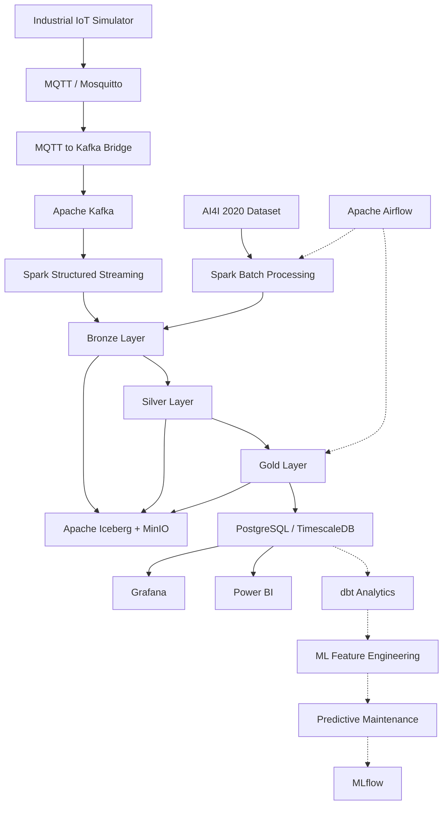

# IndustryPulse — Industrial IoT Data Platform

> An end-to-end Big Data and Industrial IoT platform combining real-time data streaming, batch processing, Lakehouse architecture, industrial analytics, and predictive maintenance.

## Overview

IndustryPulse is a personal Data Engineering project that I am developing to explore how industrial machine data can be collected, processed, stored, and analyzed using modern Big Data technologies.

The idea behind this project is to build a complete data platform rather than working with isolated tools.

I wanted to understand how technologies such as **MQTT, Apache Kafka, Apache Spark, Apache Iceberg, MinIO, TimescaleDB, Grafana, Power BI, and Apache Airflow** work together in a realistic data architecture.

The platform combines two types of data:

- **Real-time IoT telemetry:** simulated measurements generated continuously by industrial machines.
- **Historical industrial data:** the AI4I 2020 Predictive Maintenance Dataset, used for batch processing and failure analysis.

Both workflows follow a **Medallion Architecture (Bronze → Silver → Gold)**, allowing raw data to be progressively transformed into reliable datasets and industrial KPIs.

The platform currently supports data ingestion, distributed processing, Lakehouse storage, database serving, and visualization. I am now extending it with dbt Analytics, followed by Machine Learning and MLOps.

---

## Project Objectives

With IndustryPulse, my main objectives are to:

- Simulate industrial IoT devices generating continuous sensor measurements.
- Build an event-driven data pipeline using MQTT and Apache Kafka.
- Process streaming data using Spark Structured Streaming.
- Process historical datasets using Spark Batch.
- Implement a Medallion Lakehouse Architecture.
- Store analytical tables using Apache Iceberg and MinIO.
- Apply data validation, cleaning, and enrichment rules.
- Calculate machine-level KPIs using event-time windows.
- Serve processed data through PostgreSQL and TimescaleDB.
- Monitor machine performance using Grafana.
- Analyze industrial KPIs using Power BI.
- Experiment with workflow orchestration using Apache Airflow.
- Introduce analytics engineering with dbt.
- Develop predictive maintenance models using Machine Learning.

I am building the platform step by step, validating each component before moving to the next one.

---

## System Architecture



The solid connections represent the main implemented data flow. Dashed connections represent orchestration relationships or components that are being developed.

### Architecture Layers

| Layer | Technologies | Purpose |
|---|---|---|
| Data Sources | IoT Simulator, AI4I 2020 | Generate and provide industrial data |
| IoT Messaging | MQTT, Eclipse Mosquitto | Receive sensor events |
| Event Streaming | Apache Kafka | Transport streaming events |
| Processing | Apache Spark, PySpark | Batch and streaming transformations |
| Lakehouse | Apache Iceberg, MinIO | Store Bronze, Silver, and Gold datasets |
| Serving | PostgreSQL, TimescaleDB | Store and query industrial KPIs |
| Monitoring | Grafana | Visualize machine behavior |
| Business Intelligence | Power BI | Analyze operational performance |
| Orchestration | Apache Airflow | Schedule and monitor workflows |
| Analytics Engineering | dbt Core | Organize SQL transformations |
| Machine Learning | Python, MLflow | Planned predictive maintenance workflow |
| Infrastructure | Docker, Docker Compose | Containerized development environment |

---

## Technology Stack

| Category | Technologies |
|---|---|
| Programming | Python, SQL |
| IoT Communication | MQTT, Eclipse Mosquitto |
| Event Streaming | Apache Kafka |
| Distributed Processing | Apache Spark 3.5, PySpark |
| Stream Processing | Spark Structured Streaming |
| Lakehouse Table Format | Apache Iceberg |
| Object Storage | MinIO |
| Data Architecture | Medallion Architecture |
| Time-Series Database | PostgreSQL, TimescaleDB |
| Data Visualization | Grafana |
| Business Intelligence | Power BI |
| Workflow Orchestration | Apache Airflow |
| Analytics Engineering | dbt Core, dbt-postgres |
| Machine Learning | scikit-learn, MLflow (planned integration) |
| Infrastructure | Docker, Docker Compose |
| Version Control | Git, GitHub |

---

## 1. Real-Time IoT Data Pipeline

The streaming pipeline simulates measurements produced by industrial machines.

I currently work with five simulated machines:

```text
M001
M002
M003
M004
M005
```

Each machine generates measurements such as:

- Temperature
- Vibration
- Pressure
- Energy consumption
- Machine status
- Event timestamp

### Example Sensor Event

```json
{
  "machine_id": "M001",
  "temperature": 72.45,
  "vibration": 0.532,
  "pressure": 5.82,
  "energy": 43.21,
  "status": "RUNNING",
  "timestamp": "2026-10-04T14:06:25Z"
}
```

### Streaming Workflow

```text
IoT Sensor Generator
        |
        v
Eclipse Mosquitto
        |
        v
MQTT to Kafka Bridge
        |
        v
Apache Kafka
        |
        v
Spark Structured Streaming
        |
        v
Bronze Iceberg
        |
        v
Silver Iceberg
        |
        v
Gold Iceberg
        |
        v
TimescaleDB
        |
        +------> Grafana
        |
        +------> Power BI
```

I use MQTT for lightweight communication between the simulated machines and the ingestion system.

Kafka acts as the event-streaming layer, while Spark Structured Streaming processes the incoming measurements.

The processed data is then used to calculate industrial KPIs and populate the serving database.

---

## 2. Historical Batch Processing

IndustryPulse also includes a batch-processing pipeline using the **AI4I 2020 Predictive Maintenance Dataset**.

The dataset contains **10,000 observations** related to industrial equipment and machine failures.

### Main Dataset Features

- Air temperature
- Process temperature
- Rotational speed
- Torque
- Tool wear
- Machine failure
- Tool wear failure
- Heat dissipation failure
- Power failure
- Overstrain failure
- Random failure

### Batch Transformations

Using PySpark, I perform operations such as:

- Duplicate removal
- Column standardization
- Data validation
- Temperature conversion
- Temperature-difference calculation
- Mechanical-power calculation
- Industrial risk enrichment

The cleaned data is stored in the Lakehouse for further analysis.

I also use the historical dataset to study machine failure conditions and prepare the foundation for predictive maintenance.

---

## 3. Medallion Lakehouse Architecture

I implemented the **Bronze → Silver → Gold** architecture to separate raw ingestion, data cleaning, and business-oriented transformations.

### Bronze Layer — Raw Data

The Bronze layer stores incoming data with minimal transformations.

Iceberg tables:

```text
industrypulse.bronze.ai4i_raw
industrypulse.bronze.machine_sensors_raw
```

For streaming events, I preserve Kafka metadata, including:

- Kafka partition
- Kafka offset
- Kafka timestamp
- Ingestion timestamp

This helps with data traceability and debugging.

### Silver Layer — Cleaned Data

The Silver layer contains validated and enriched data.

Iceberg tables:

```text
industrypulse.silver.ai4i_clean
industrypulse.silver.machine_sensors_clean
```

The streaming pipeline validates measurements and generates additional fields:

```text
temperature_alert
vibration_alert
sensor_alert
data_quality_status
processing_timestamp
```

### Gold Layer — Analytical KPIs

The Gold layer contains aggregated datasets used for monitoring and analysis.

Main Iceberg table:

```text
industrypulse.gold.machine_kpi
```

The streaming pipeline calculates KPIs using **one-minute event-time windows**.

These KPIs include:

| KPI | Description |
|---|---|
| Total Measurements | Number of received measurements |
| Average Temperature | Mean machine temperature |
| Minimum Temperature | Lowest recorded temperature |
| Maximum Temperature | Highest recorded temperature |
| Average Vibration | Mean vibration level |
| Maximum Vibration | Highest vibration level |
| Average Pressure | Mean pressure |
| Average Energy | Mean energy consumption |
| Total Alerts | Number of detected alerts |
| Alert Rate | Frequency of alerts |

The Gold data provides a structured foundation for dashboards and further analytical transformations.

---

## 4. Data Quality and Alert Detection

Data quality is an important part of the streaming pipeline.

I apply validation rules to detect invalid or inconsistent sensor measurements.

### Validation Rules

```text
machine_id       -> required
event_timestamp  -> required

0 <= temperature <= 150
0 <= vibration   <= 5
0 <= pressure    <= 20
energy          >= 0
```

Invalid records are identified using the `data_quality_status` field.

### Alert Detection

The project uses the following simulation thresholds:

```text
Temperature > 85°C -> Temperature Alert

Vibration > 1.0    -> Vibration Alert

Temperature Alert OR Vibration Alert
                   -> Sensor Alert
```

These thresholds are used for simulation and learning purposes. They are not intended to represent universal industrial safety limits.

The resulting alerts are included in the Gold KPI calculations.

---

## 5. Lakehouse Storage — Apache Iceberg and MinIO

I use **Apache Iceberg** as the analytical table format and **MinIO** as S3-compatible object storage.

The Iceberg warehouse is configured under:

```text
s3a://industrypulse/warehouse
```

### Logical Lakehouse Structure

```text
industrypulse
|
+-- bronze
|   +-- ai4i_raw
|   +-- machine_sensors_raw
|
+-- silver
|   +-- ai4i_clean
|   +-- machine_sensors_clean
|
+-- gold
    +-- machine_kpi
```

This architecture separates storage from processing and makes it easier to organize data for different analytical needs.

---

## 6. Serving Layer — PostgreSQL and TimescaleDB

After building the Lakehouse, I integrated **TimescaleDB**, based on PostgreSQL, to serve processed industrial data.

The main table is:

```text
public.machine_kpi
```

It contains machine-level KPIs with time-window information.

### Main Columns

```text
machine_id
window_start
window_end
total_measurements
avg_temperature
min_temperature
max_temperature
avg_vibration
max_vibration
avg_pressure
avg_energy
total_alerts
alert_rate
gold_processing_timestamp
```

### Example Query

```sql
SELECT
    machine_id,
    window_start,
    avg_temperature,
    avg_vibration,
    avg_energy,
    total_alerts,
    alert_rate
FROM public.machine_kpi
ORDER BY window_start DESC
LIMIT 20;
```

The database also contains historical failure-analysis tables:

```text
public.ai4i_failure_conditions
public.ai4i_failure_summary
public.ai4i_failure_types
```

These tables support industrial failure analysis and reporting.

### Why TimescaleDB?

I selected TimescaleDB because it extends PostgreSQL with functionality designed for time-series workloads.

It is a useful choice for querying machine measurements over time and connecting the results to visualization tools.

---

## 7. Industrial Monitoring with Grafana

I integrated Grafana to visualize the operational data stored in TimescaleDB.

The dashboard includes:

- Temperature monitoring
- Vibration monitoring
- Energy consumption
- Active machines
- Average alert rate
- Total alerts
- Vibration over time
- Energy over time
- Machine selection

The dashboard helps me understand how machine behavior changes over time and identify unusual measurements.

I also experimented with alert thresholds and time-range filtering.

One important lesson was that dashboard queries depend on the timestamps available in the database. When the selected time range does not match the stored measurements, panels may show no data even when the pipeline is working.

---

## 8. Business Analytics with Power BI

In addition to Grafana, I developed a **Power BI dashboard** for industrial data analysis.

I use Power BI to explore the analytical side of the platform and present operational KPIs in a more business-oriented format.

Using both tools allows me to compare different approaches to visualization:

- **Grafana:** operational monitoring and time-series visualization.
- **Power BI:** analytical reporting and performance analysis.

The Power BI dashboard is already part of the project. I plan to improve the analytical models feeding it as the dbt layer develops.

---

## 9. Workflow Orchestration — Apache Airflow

I integrated **Apache Airflow** to experiment with workflow orchestration.

The objective is to manage processing tasks through DAGs, monitor their execution, and understand how data pipelines can be automated.

I have successfully tested Airflow workflow executions.

### What I Learned

During testing, I noticed that running many Docker services simultaneously could affect the stability of my local environment.

In particular, combining the complete streaming platform with frequently scheduled Airflow workflows increased resource usage.

For this reason, I currently run Airflow only when needed instead of keeping it active continuously.

This approach allows me to continue developing the platform without unnecessarily consuming local resources.

---

## 10. Analytics Engineering — dbt

I am currently integrating **dbt Core** to organize SQL transformations on top of TimescaleDB.

The objective is to create reusable analytical models, improve data quality, and prepare structured datasets for future Machine Learning tasks.

### Current dbt Structure

```text
dbt/
|
+-- Dockerfile
+-- dbt_project.yml
+-- profiles.yml
|
+-- models/
|   +-- staging/
|   +-- marts/
|
+-- tests/
```

### Current Progress

I have prepared:

- The dbt project configuration
- The PostgreSQL connection profile
- A Dockerfile for the dbt environment
- Directories for staging models, analytical marts, and tests

### Next Steps

1. Build and validate the dbt Docker image.
2. Test the connection with `dbt debug`.
3. Create a staging model for `machine_kpi`.
4. Build analytical marts for machine performance.
5. Add dbt data quality tests.
6. Prepare SQL features for predictive maintenance.

**Status:** Configuration prepared; model development and execution are still in progress.

---

## 11. Docker Infrastructure

I use Docker and Docker Compose to run the different services in isolated containers.

This allows me to reproduce the development environment and manage each component separately.

### Main Services

```text
Eclipse Mosquitto
Apache Kafka
Apache Spark
MinIO
PostgreSQL / TimescaleDB
Grafana
Apache Airflow (on demand)
```

Other development components include dbt and the planned Machine Learning environment.

### Start the Infrastructure

```bash
docker compose up -d
```

### Start with the Streaming Configuration

```bash
docker compose \
  -f docker-compose.yml \
  -f docker-compose.streaming.yml \
  up -d
```

### Check Containers

```bash
docker ps
```

### Stop Services

```bash
docker compose \
  -f docker-compose.yml \
  -f docker-compose.streaming.yml \
  down
```

I avoid deleting persistent Docker volumes during normal development because they contain important data and application state.

---

## 12. Project Structure

The main repository is organized around the following components:

```text
IndustryPulse/
|
+-- data/
|   +-- raw/
|       +-- ai4i2020.csv
|
+-- mosquitto/
|   +-- config/
|   +-- data/
|   +-- log/
|
+-- spark/
|   +-- spark_batch.py
|   +-- spark_streaming.py
|   +-- iceberg_batch.py
|   +-- spark_streaming_iceberg.py
|   +-- spark_silver_streaming.py
|   +-- spark_gold_streaming.py
|   +-- test_minio.py
|
+-- src/
|   +-- iot_generator.py
|   +-- mqtt_to_kafka.py
|
+-- airflow/
|   +-- dags/
|
+-- dbt/
|   +-- Dockerfile
|   +-- dbt_project.yml
|   +-- profiles.yml
|   +-- models/
|       +-- staging/
|       +-- marts/
|   +-- tests/
|
+-- docker-compose.yml
+-- docker-compose.streaming.yml
+-- .gitignore
+-- README.md
```

This represents the main project organization. Some additional scripts and configuration files may be present as the platform evolves.

---

## 13. Getting Started

### Prerequisites

Before running IndustryPulse, install:

- Docker Desktop
- Docker Compose
- Git
- Python 3, if running local Python scripts

### Clone the Repository

```bash
git clone https://github.com/oumaymazerrik/IndustryPulse-Industrial-IoT-Data-Platform.git

cd IndustryPulse-Industrial-IoT-Data-Platform
```

### Start the Infrastructure

```bash
docker compose up -d
```

Check that the containers are running:

```bash
docker ps
```

### Run the IoT Generator

```bash
python src/iot_generator.py
```

### Run the MQTT-to-Kafka Bridge

In another terminal:

```bash
python src/mqtt_to_kafka.py
```

If these scripts are executed locally, their dependencies include:

```bash
pip install paho-mqtt kafka-python
```

### Run Bronze Streaming

```bash
docker exec -it industrypulse-spark spark-submit \
  --packages org.apache.spark:spark-sql-kafka-0-10_2.12:3.5.0,org.apache.iceberg:iceberg-spark-runtime-3.5_2.12:1.10.0,org.apache.hadoop:hadoop-aws:3.3.4 \
  /app/spark/spark_streaming_iceberg.py
```

### Run Silver Streaming

```bash
docker exec -it industrypulse-spark spark-submit \
  --packages org.apache.iceberg:iceberg-spark-runtime-3.5_2.12:1.10.0,org.apache.hadoop:hadoop-aws:3.3.4 \
  /app/spark/spark_silver_streaming.py
```

### Run Gold Processing

```bash
docker exec -it industrypulse-spark spark-submit \
  --packages org.apache.iceberg:iceberg-spark-runtime-3.5_2.12:1.10.0,org.apache.hadoop:hadoop-aws:3.3.4 \
  /app/spark/spark_gold_streaming.py
```

These commands illustrate the processing jobs used during development. Depending on the current Docker configuration, the required services and environment variables must be available before running them.

### Prepare dbt

Build the Docker image:

```bash
docker build -t industrypulse-dbt ./dbt
```

Verify the installation:

```bash
docker run --rm industrypulse-dbt --version
```

The database connection and model execution will be configured and tested in the next development phase.

---

## 14. Example SQL Analytics

### Recent Machine KPIs

```sql
SELECT
    machine_id,
    window_start,
    window_end,
    total_measurements,
    avg_temperature,
    avg_vibration,
    avg_energy,
    total_alerts
FROM public.machine_kpi
ORDER BY window_start DESC;
```

### Machine Performance Summary

```sql
SELECT
    machine_id,
    ROUND(AVG(avg_temperature)::numeric, 2)
        AS avg_temperature,
    ROUND(MAX(max_temperature)::numeric, 2)
        AS max_temperature,
    ROUND(AVG(avg_vibration)::numeric, 3)
        AS avg_vibration,
    SUM(total_alerts)
        AS total_alerts,
    ROUND(AVG(alert_rate)::numeric, 2)
        AS avg_alert_rate
FROM public.machine_kpi
GROUP BY machine_id
ORDER BY total_alerts DESC;
```

These queries can be used to explore machine performance and alert behavior over time.

---

## 15. Challenges and Lessons Learned

This project has helped me understand that building a data platform involves much more than writing code.

Some of the most interesting challenges I encountered were related to system integration, state management, and debugging.

### Streaming Checkpoints and Kafka Offsets

During development, I encountered a Spark streaming checkpoint issue related to Kafka offsets.

Before recovering the streaming job, I created a backup of the existing checkpoint in MinIO.

This experience helped me better understand checkpoint management, offset tracking, and the importance of protecting streaming state.

### Dashboard Data Freshness

At one point, some Grafana panels displayed no data even though records existed in TimescaleDB.

I investigated the database timestamps and dashboard time ranges to understand the issue.

This taught me to verify data freshness and time-window filters when debugging monitoring systems.

### Docker Resource Management

Running Kafka, Spark, MinIO, TimescaleDB, Grafana, and Airflow on the same local machine requires careful resource management.

I experienced Docker stability issues when several heavy services and frequent orchestration tasks were running simultaneously.

I now start services selectively based on the component I am developing or testing.

### Incremental Development

Instead of integrating everything at once, I validate each stage independently:

- IoT event generation
- MQTT communication
- Kafka ingestion
- Spark processing
- Iceberg storage
- TimescaleDB serving
- Dashboard visualization

This makes it easier to identify problems and understand how each component contributes to the complete architecture.

---

## 16. Current Project Status

| Component | Status |
|---|---|
| IoT Machine Simulator | Completed and Tested |
| MQTT / Eclipse Mosquitto | Completed and Tested |
| MQTT-to-Kafka Bridge | Completed and Tested |
| Apache Kafka | Completed and Tested |
| Spark Batch Processing | Implemented |
| Spark Structured Streaming | Implemented |
| MinIO Object Storage | Integrated |
| Apache Iceberg | Integrated |
| Historical Bronze Layer | Implemented |
| Historical Silver Layer | Implemented |
| Streaming Bronze Layer | Implemented |
| Streaming Silver Layer | Implemented |
| Streaming Data Quality | Implemented |
| Streaming Gold KPI Layer | Implemented |
| PostgreSQL / TimescaleDB | Integrated |
| Grafana Dashboard | Implemented |
| Power BI Dashboard | Implemented |
| Apache Airflow | Successful Test Runs |
| dbt Project Configuration | Prepared |
| dbt SQL Models and Tests | In Progress |
| Predictive Maintenance ML | Planned |
| MLflow Experiment Tracking | Planned |

---

## 17. Roadmap

### Phase 1 — Data Ingestion and Lakehouse

**Implemented**

- IoT sensor simulation
- MQTT and Kafka integration
- Spark batch and streaming processing
- Bronze, Silver, and Gold layers
- Apache Iceberg and MinIO

### Phase 2 — Serving and Visualization

**Implemented**

- TimescaleDB integration
- Machine KPI storage
- Grafana monitoring
- Power BI reporting
- Historical failure-analysis tables

### Phase 3 — Workflow Orchestration

**Tested**

- Apache Airflow integration
- DAG execution
- Workflow monitoring

Further improvements will focus on orchestration reliability and resource usage.

### Phase 4 — Analytics Engineering

**In Progress**

- dbt Docker environment
- PostgreSQL connection testing
- Staging models
- Analytical data marts
- Data quality tests
- SQL documentation

### Phase 5 — Predictive Maintenance

**Planned**

- Exploratory Data Analysis
- Feature engineering
- Machine failure prediction
- Model comparison
- Evaluation metrics
- Model explainability

### Phase 6 — MLOps

**Planned**

- MLflow experiment tracking
- Model registry
- Model versioning
- Reproducible training
- Model serving
- Prediction monitoring

---

## 18. Engineering Concepts Practiced

Through IndustryPulse, I am gaining practical experience with:

- End-to-End Data Engineering
- Industrial Internet of Things (IIoT)
- Event-Driven Architecture
- Distributed Data Processing
- Batch and Stream Processing
- Apache Kafka
- Spark Structured Streaming
- Data Lakehouse Architecture
- Apache Iceberg
- S3-Compatible Object Storage
- Medallion Architecture
- Data Quality and Validation
- Event-Time Processing
- Windowed Aggregations
- Time-Series Databases
- SQL Analytics
- Data Visualization
- Workflow Orchestration
- Dockerized Infrastructure
- Streaming Checkpoint Management
- Analytics Engineering

---

## 19. Security Considerations

IndustryPulse is currently a local development and educational project.

Some services use simplified configurations suitable for experimentation.

A production deployment would require additional security measures, including:

- MQTT authentication
- TLS encryption
- Kafka authentication and authorization
- Secure credential management
- Network isolation
- MinIO access policies
- Role-based access control
- Monitoring and auditing

Passwords, tokens, and other sensitive credentials should never be committed to the repository.

---

## 20. Author

**Oumayma Zerrik**

Master's Student — Big Data & IoT

Interested in **Data Engineering, Big Data, Artificial Intelligence, Cloud, and MLOps**.

GitHub: [oumaymazerrik](https://github.com/oumaymazerrik)

---

## Project Status

**Active Development — October 2026**

IndustryPulse is an evolving personal project. My objective is to progressively build a complete industrial data platform, from raw IoT events to analytical insights and predictive maintenance.

I am continuing to improve the architecture, test integrations, and document the engineering decisions and challenges encountered along the way.
